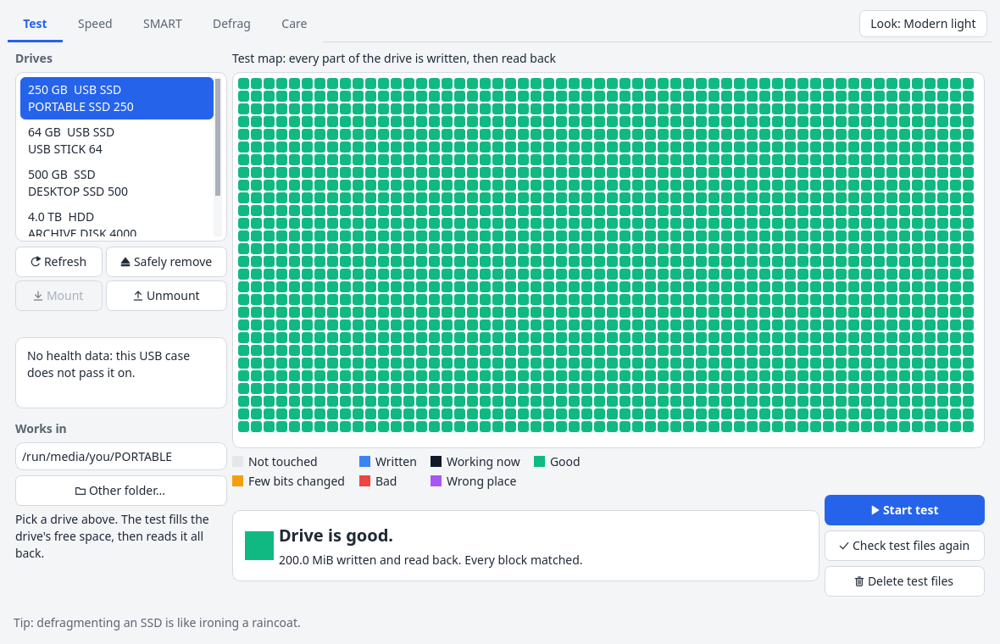
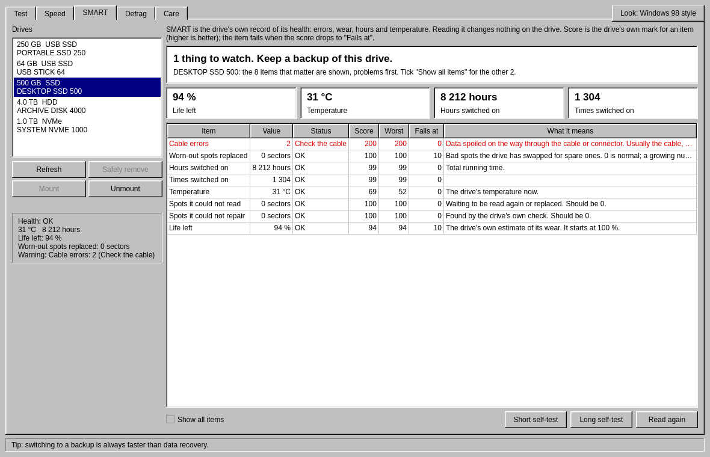
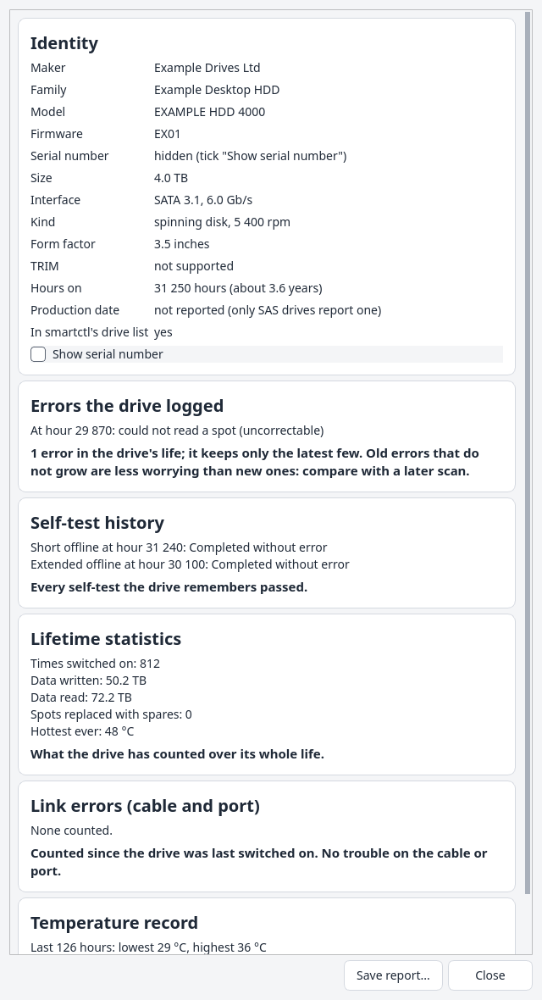
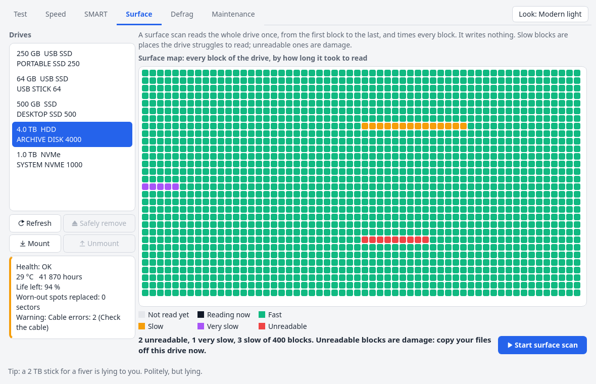

# Disky Business

**Can this drive be trusted?** Disky Business fills a drive with test data, reads every block back and shows
the answer on a live block map, the way old defragmenters did.



For a second-hand SSD, a USB stick that may lie about its size, or an old disk you are not sure of.
Linux only. Works, not yet released.

## What it does

| Tab | |
|---|---|
| **Test** | Fills the free space, reads it back from the drive (not from memory) and gives a plain verdict. Finds fake-capacity sticks and bad blocks. Uses the f3 / H2testw method and file format |
| **Speed** | Sequential and small random reads and writes: four big results with bars, and a graph of the speed along the file |
| **SMART** | The drive's own health record in plain words: worn-out spots, unreadable spots, cable errors, life left, temperature. Short and long self-tests. Drives in USB cases are read with `smartctl` after asking. **Deep scan**: maker, firmware, past errors, self-test history, lifetime statistics and a text report |
| **Surface** | Reads the whole drive once without writing anything, times every block and maps the slow and the unreadable ones. Leaves drives with a Windows (NTFS) partition alone |
| **Defrag** | How fragmented the files are. "Defragment all" works through every fragmented file on btrfs, ext4 and XFS with the system's own tool, and proves after each that its content is unchanged |
| **Maintenance** | Checks a partition's file system and repairs it with the system's own tool, after showing the warnings that apply. For SSDs, says whether TRIM is needed (is Linux's weekly TRIM on, when did it last run) and offers "Trim now" |







Five looks: Modern light and Modern dark (following your system), Windows 98 style, Dark and Deep violet.

## Safe by design

- Never overwrites or deletes your files. It writes only its own test files, never into a folder that already
  has some, and removes only files that really hold its test data, after asking.
- Leaves free space on the drive your system runs from, and checks it again while writing.
- Never reads Windows (NTFS) drives, which Linux may change just by reading them.
- The admin password is asked once per session, not once per job. A small helper then stays until you close
  the app (or press "End") and runs only Disky's own fixed jobs. Most things need no password at all.
- Stop works at any moment (a repair, once started, is left to finish).
- Mount, Unmount and Safely remove are in the drive list; the system and home partitions are never unmounted.
- Never defragments a file that shares its data with a btrfs snapshot or a copy (it would be stored twice), and
  does not call compressed btrfs files fragmented because they are stored in 128 KiB pieces.

## Tested on real drives

| Drive | Result |
|---|---|
| 120 GB SATA SSD in a USB case | Whole drive, written and read back: good, 40 min. One sector damaged on purpose was found exactly |
| 500 GB hard disk in a USB case | 360 GiB of free space, written and read back: good, 5 h; the files already on it untouched |
| 500 GB hard disk in a USB case | Surface scan through the window, read-only: the first 7 GiB at about 79 MiB/s, every block in good time, stopped within a second. A whole-drive pass has not been run yet |
| Internal NVMe | TRIM through the window: 140 GiB trimmed |
| 7 internal drives | SMART read and explained; item names match `smartctl` |
| SATA SSD, SATA hard disk, NVMe, two drives in USB cases | Deep scan read by `disky smart --deep`; one drive's three logged errors shown |
| 10 drives (3 NVMe, 4 internal SATA, 3 on USB) | Deep scan through the window, one password for all ten; each saved report keeps the serial number out until it is ticked |
| btrfs home (zstd compression, Timeshift snapshots) | 56 031 files scanned in 3 s; 1 262 snapshot-shared files left alone (25.9 GiB not stored twice); a fragmented file defragmented from 64 pieces to 1, content unchanged |
| Real test files damaged on purpose (2.1 GiB) | A flipped bit, a zeroed sector, data from another place (fake capacity), a missing file, a short file and a torn file: each found, with its place |
| SATA SSD, speed test twice | 382 MiB/s write and 522 MiB/s read both times |
| NVMe, 3 SATA SSDs, a 2 TB hard disk, a USB stick | All listed (NVMe too) and SMART explained; a hard disk's worn head parking (score 1) flagged; its packed timeout count shown as 32, not 4 296 933 408 |

Test files are read correctly by `f3read` 8.0, and `f3write` 8.0's files by Disky Business.

## Latest changes (28 November 2026)

- **Surface scan** (new tab): a read-only pass over the whole drive that maps slow and unreadable blocks.
- **Other tabs can be looked at while one works**; they start nothing until it is done.
- **Nothing crosses a drive that is being changed**: Check, Repair and Trim wait while a drive is being mounted
  or unmounted, and a repair runs only on the partition you confirmed, checked once more after your yes.
- **A slow or failing drive no longer hangs the window**: the drive list, a drive's folder and its SMART record
  are read in the background.
- **One odd entry no longer hides the rest**: a device or SMART item the system describes in an unexpected way
  is left out, and everything else is still shown.
- **Closing the window during a job asks first**, with a stronger warning during a repair.
- **TRIM says whether it is needed and why**; the Care tab is now called Maintenance.
- **Deep scan** (27 November): a drive's identity, firmware, past errors, self-test history and lifetime
  statistics in their own window, with a text report. The serial number stays hidden until you ask for it.

## How it is tested

About 330 automated tests, run on every change on two Python versions. Each new test is first shown to fail on
broken code. Beyond that: independent code reviews, random and malformed data thrown at everything that reads
outside input (drive service, smartctl, mount table, exFAT volumes, the admin helper), thousands of random
clicks in the window, and faults injected into test files on a real disk, which must be found at the exact spot.
It has run on one machine so far; see [CONTRIBUTING.md](CONTRIBUTING.md) for what is known to be unfinished.

## Run it

Needs Python 3.11+, numpy 2 and PySide6. Drive list and SMART come from udisks2; smartmontools, if installed,
supplies makers' names for SMART items.

```
git clone https://github.com/grumpybollocks/disky-business && cd disky-business
python3 -m diskygui                     # the window
pip install '.[gui]'                    # or install it: gives `disky-business` and `disky`
```

The engine also runs on its own: `disky test|write|verify|clean|speed|fragfiles|defrag|defragall|fragscan|trim|
smart|selftest|surface|fscheck|fsrepair <target>`. Every result is said in plain words; `--json` gives one line per
event instead (see [docs/CONTRACT.md](docs/CONTRACT.md)). `disky smart <drive> --deep` is the Deep scan.

## More

[How to use it](docs/GUIDE.md) · [How it is built](docs/BRICKS.md) · [What the engine prints](docs/CONTRACT.md) ·
[Contributing](CONTRIBUTING.md)

Built on the method and file format of [f3](https://github.com/AltraMayor/f3) by Michel Machado, which follows
H2testw by Harald Bögeholz. The code is Disky Business's own.

GPL-3.0-or-later.
